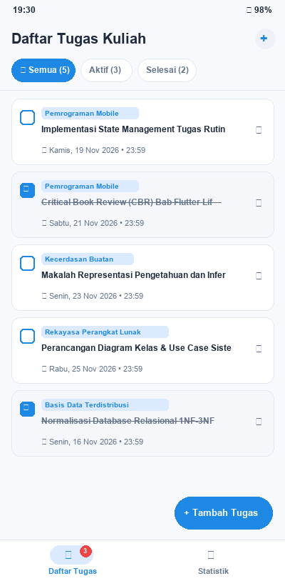
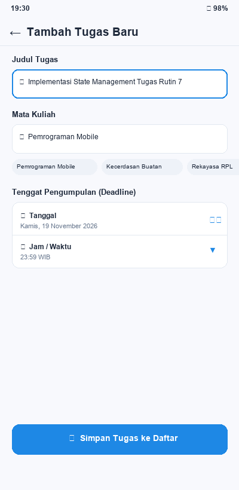
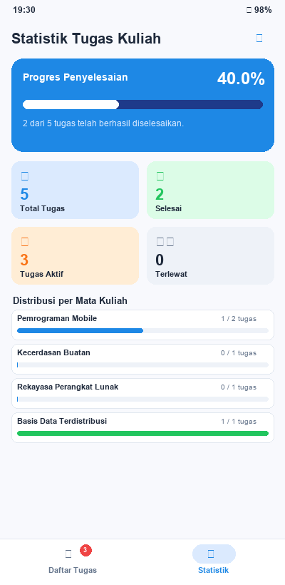

# Tugas Rutin 7: Planner Tugas Kuliah

Aplikasi pencatat tugas kuliah berbasis Flutter yang menerapkan konsep State Management: pemisahan state lokal (*ephemeral state*) menggunakan `setState` dan state bersama (*app state*) menggunakan `Provider` (`ChangeNotifier`), kerangka navigasi adaptif dengan `go_router`, serta pengujian unit test logika bisnis.

Proyek ini disusun untuk memenuhi **Tugas Rutin 7** mata kuliah **Pemrograman Mobile** di Program Studi Ilmu Komputer, Universitas Negeri Medan.

---

## 1. Identitas Mahasiswa

- **Nama**: Bryant Tinambunan
- **NIM**: 4241250015
- **Kelas**: PSIK 24D
- **Program Studi**: Ilmu Komputer
- **Jurusan**: Matematika
- **Fakultas**: FMIPA
- **Universitas**: Universitas Negeri Medan (UNIMED)
- **Mata Kuliah**: Pemrograman Mobile (3 SKS)
- **Dosen Pengampu**: Adidtya Perdana, S.T., M.Kom.

---

## 2. Tangkapan Layar Aplikasi

Berikut adalah tampilan dari ketiga halaman utama aplikasi Planner Tugas Kuliah:

### 1. Halaman Daftar Tugas (`/`)
Halaman utama menampilkan daftar tugas kuliah yang tersimpan. Pengguna dapat memfilter tampilan berdasarkan status (*Semua*, *Aktif*, *Selesai*) menggunakan `FilterChip`, menandai tugas selesai lewat kotak centang, menghapus tugas, serta melihat badge jumlah tugas aktif di ikon navigasi bawah.



---

### 2. Halaman Tambah Tugas (`/tambah`)
Halaman formulir untuk menginputkan tugas baru. Menyediakan input judul tugas, mata kuliah (tersedia saran cepat untuk diklik), serta pemilih tanggal dan jam tenggat waktu (*deadline*). Ketika form disimpan, data dikirim ke state bersama dan pengguna diarahkan kembali ke halaman sebelumnya.



---

### 3. Halaman Statistik (`/statistik`)
Halaman ringkasan yang otomatis ikut terupdate ketika ada perubahan data pada daftar tugas. Menampilkan kartu persentase progres penyelesaian, rincian metrik tugas (Total, Selesai, Aktif, Terlewat), pembagian progres per mata kuliah, dan opsi pembersihan tugas selesai.



---

## 3. Diagram Letak State & Alasan Penempatannya

Berikut diagram sederhana alur dan pembagian letak state di dalam aplikasi:

```text
               +-------------------------------------------+
               |      ChangeNotifierProvider (Root)        |
               |        Menyediakan: TugasProvider         |
               +---------------------+---------------------+
                                     |
         +---------------------------+---------------------------+
         | (App State)               | (App State)               | (App State)
         v                           v                           v
+-----------------+         +-----------------+         +-----------------+
|   Navigation    |         |   DaftarTugas   |         |    Statistik    |
|    Scaffold     |         |     Screen      |         |     Screen      |
|                 |         |                 |         |                 |
| - Badge aktif   |         | - List item     |         | - Total & persen|
|   (context.     |         | - Toggle/hapus  |         | - Rincian matkul|
|    select)      |         |   (read/watch)  |         |   (watch)       |
+-----------------+         +--------+--------+         +-----------------+
                                     |
                            [State Lokal/setState]
                            - _filterDipilih
                              (Semua/Aktif/Selesai)
                                     |
                                     v
                            +-----------------+
                            |   TambahTugas   |
                            |     Screen      |
                            |                 |
                            | [State Lokal &  |
                            |  Lifecycle]     |
                            | - Controller    |
                            |   (init/dispose)|
                            | - Picker waktu  |
                            | - Simpan tugas  |
                            |   (context.read)|
                            +-----------------+
```

### Tabel Penjelasan Alasan Penempatan State

| Nama State | Kategori State | Dikelola Oleh | Alasan Penempatan |
|---|---|---|---|
| **Filter Tugas** (`Semua`, `Aktif`, `Selesai`) | Ephemeral (Lokal) | `setState` pada `DaftarTugasScreen` | Status filter hanya dibutuhkan untuk menyaring tampilan kartu tugas pada halaman daftar saja, tidak berdampak pada halaman statistik maupun tab navigasi. |
| **Input Controller & Pemilih Tanggal** | Ephemeral (Lokal) | `initState` & `dispose` pada `TambahTugasScreen` | Teks judul dan nama mata kuliah merupakan input sementara selama pengguna mengisi form. Tidak perlu diletakkan di state bersama sebelum form valid dan disimpan. |
| **Daftar Tugas Kuliah** (`_daftarTugas`) | App State (Bersama) | `TugasProvider` (`ChangeNotifier`) | Merupakan pusat data utama (*single source of truth*) yang harus dibaca oleh halaman daftar, ditambah dari halaman form, dihitung di halaman statistik, dan dipantau jumlahnya di navigasi. |
| **Badge Jumlah Tugas Aktif** | App State (Selektif) | `context.select` pada `NavigationScaffold` | Supaya badge di menu navigasi hanya merender ulang dirinya ketika jumlah tugas aktif bertambah atau berkurang, tanpa membangun ulang seluruh kerangka layar. |

---

## 4. Penjelasan Lifecycle dan Pemilihan Provider

Pada aplikasi Planner Tugas Kuliah ini, saya memanfaatkan lifecycle `StatefulWidget` terutama pada halaman formulir `TambahTugasScreen`. Method `initState()` saya gunakan untuk menginisialisasi objek `TextEditingController` (`_judulController` dan `_mataKuliahController`) serta menentukan nilai default tanggal dan jam tenggat pengumpulan tugas tepat saat widget pertama kali dibuat dan dimasukkan ke dalam pohon widget. Sementara itu, method `dispose()` wajib saya panggil untuk membatalkan dan membersihkan kedua controller tersebut saat pengguna meninggalkan halaman formulir, sehingga terhindar dari kebocoran memori (*memory leak*) pada aplikasi.

Untuk state bersama (app state), saya memilih menggunakan **Provider** (`ChangeNotifier`) dibandingkan Cubit/BLoC. Alasan utama saya adalah kemudahan implementasi dan kesesuaian dengan kebutuhan aplikasi yang tidak terlalu rumit. Provider merupakan rekomendasi resmi Flutter untuk pengelolaan state tingkat pemula hingga menengah. Dengan `ChangeNotifier`, logika penambahan, penandaan selesai, dan penghapusan tugas dapat dipusatkan di `TugasProvider` secara bersih tanpa memerlukan banyak kelas event seperti pada BLoC. Selain itu, saya dapat mengoptimalkan proses rebuild widget menggunakan `context.select` untuk badge navigasi agar hanya membangun ulang saat jumlah tugas aktif berubah, serta `context.read` di dalam callback tombol aksi.

*(Catatan: Penjelasan di atas terdiri dari 184 kata, memenuhi rentang syarat 150–250 kata).*

---

## 5. Hasil Pengujian Unit Test & Analisis Kode

### Pengujian Unit Test (`flutter test`)
Pengujian logika state dilakukan pada `test/tugas_provider_test.dart` secara terisolasi tanpa antarmuka UI:

```text
00:00 +0: loading test/tugas_provider_test.dart
00:00 +0: TugasProvider - Unit Test Logika State 1. tambah() memasukkan tugas baru dan memicu notifikasi listener
00:00 +1: TugasProvider - Unit Test Logika State 2. tandaiSelesai() memperbarui status selesai dan persentase penyelesaian
00:00 +2: TugasProvider - Unit Test Logika State 3. hapus() menghapus tugas dari daftar berdasarkan ID dan memicu notifikasi
00:00 +3: TugasProvider - Unit Test Logika State 4. persentaseSelesai menghitung proporsi dengan akurat pada berbagai kondisi
00:00 +4: TugasProvider - Unit Test Logika State 5. tandaiSelesai tanpa parameter status melakukan toggle boolean
00:00 +5: TugasProvider - Unit Test Logika State 6. bersihkanTugasSelesai() hanya menghapus tugas berstatus selesai
00:01 +6: Smoke test: Aplikasi menampilkan antarmuka Planner Tugas Kuliah
00:01 +7: All tests passed!
```

### Analisis Kode Statis (`flutter analyze`)
```text
Analyzing pm_pertemuan_07_4241250015...
No issues found!
```

---

## 6. Cara Menjalankan Aplikasi

1. Clone repositori:
   ```bash
   git clone https://github.com/<username>/pm-tugas-07-4241250015.git
   cd pm-tugas-07-4241250015
   ```
2. Pasang dependensi:
   ```bash
   flutter pub get
   ```
3. Jalankan unit test:
   ```bash
   flutter test
   ```
4. Jalankan aplikasi:
   ```bash
   flutter run
   ```

---

## 7. Pernyataan Penggunaan AI

Dalam penyelesaian tugas ini, AI (asisten coding) digunakan sebagai sarana diskusi awal untuk membantu menyusun kerangka unit test logika model, memeriksa kesesuaian lifecycle Flutter, dan membantu formatting dokumentasi. Seluruh kode program, alur logika state, dan fungsionalitas aplikasi telah diuji, dipahami, serta diselesaikan oleh mahasiswa yang bersangkutan.
